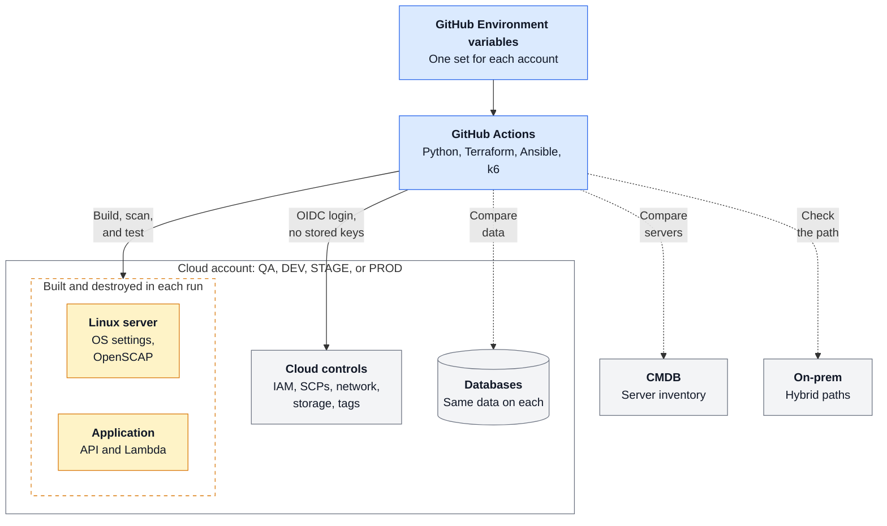
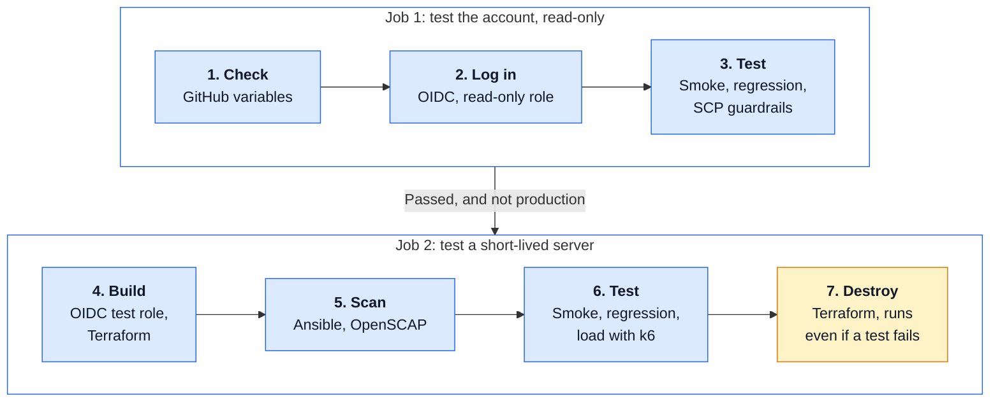
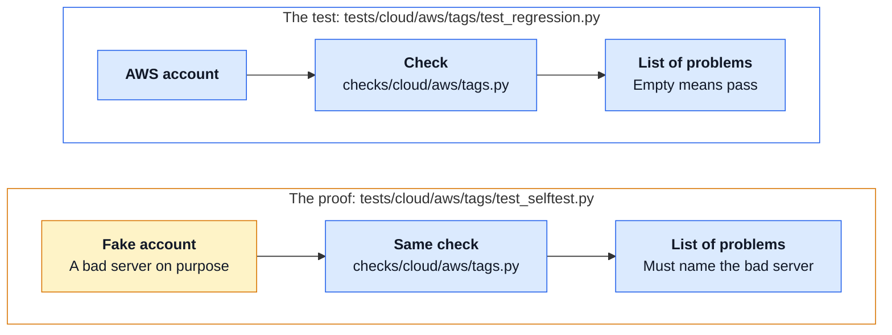

# AWS QA Framework

A modular Python test framework for cloud platforms, servers, applications, and databases.
It is built to run from **GitHub Actions** across QA, DEV, STAGE, and PROD accounts, with no stored credentials.

## The big picture



Dashed lines are optional. Each one turns on when that system is connected.

**Each tool does one job.** Python decides pass or fail for everything. Terraform builds.
Ansible reaches servers and collects evidence. k6 creates traffic.

## What a run does



This is [live.yml](.github/workflows/live.yml), for real accounts. It stays off until you turn it on.
[ci.yml](.github/workflows/ci.yml) runs on every change, with fake AWS and sample databases.

## Status

This is a personal project, to show how I approach testing a cloud platform.
It is not connected to any company's systems.

**Tested:** the full suite with fake AWS, real PostgreSQL, and real k6, on macOS and Linux.
Ansible and OpenSCAP on a real Rocky Linux 9 server.

**Not run yet:** real AWS accounts (Terraform, OIDC, Systems Manager, SCPs, and RDS login),
a real RHEL image, a real Debian server, and a live CMDB. The first real run may need small fixes.

## Where everything is

There is one folder for each tool. In Python, `checks/` and `tests/` use the same folder names.

```
ansible/                 Servers: inventory and playbooks
docs/                    Test plan, test cases, security, setup guide
k6/                      Load test scripts
sample_app/              A small sample app, so the tests have something to test
terraform/
└── aws/                 One folder for each cloud
    ├── oidc/            One-time account setup
    └── test_env/        The short-lived test server
python/
├── config/              One file for each account
├── framework/           The main framework: settings, variables, on and off switches
├── checks/              HOW to check
│   ├── cloud/aws/       audit, iam, network, scp, serverless, storage, tags
│   ├── os/              linux
│   ├── shared/          database, load, ports
│   └── cmdb.py
└── tests/               WHAT to check. All tests are here.
    ├── apps/
    │   └── sample_app/  api, code, database, load, serverless
    ├── cloud/
    │   └── aws/         audit, iam, network, scp, serverless, storage, tags
    ├── cmdb/
    ├── framework/       Tests for the framework itself
    ├── onprem/
    │   └── network/
    ├── os/
    │   └── linux/       rhel, deb, ports
    └── shared/          Tests for the shared checks
```

## How one check works



**To follow the code,** open these in order:

1. [checks/cloud/aws/tags.py](python/checks/cloud/aws/tags.py): the check
2. [tests/cloud/aws/tags/test_regression.py](python/tests/cloud/aws/tags/test_regression.py): the test
3. [tests/cloud/aws/tags/test_selftest.py](python/tests/cloud/aws/tags/test_selftest.py): the proof
4. [conftest.py](python/conftest.py): the switch between fake AWS and a real account
5. [config/](python/config/): what each account runs

## Add something new

Add a folder. pytest finds it, and there is no list to update.

| You want to add | Tests go in `python/tests/` | Checks go in `python/checks/` |
|---|---|---|
| A test for AWS IAM | `cloud/aws/iam/` | `cloud/aws/iam.py` |
| A new AWS topic | `cloud/aws/<topic>/` | `cloud/aws/<topic>.py` |
| Another cloud, such as Azure or OCI | `cloud/azure/iam/` | `cloud/azure/iam.py` |
| An app, such as web or mobile | `apps/web/` | `shared/`, or a new file |
| A Linux family, or Windows | `os/linux/<family>/`, `os/windows/` | `os/windows.py` |
| An on-prem system | `onprem/<topic>/` | `onprem/<topic>.py` |

A folder can have its own `settings.yaml` for its rules, and its own `conftest.py` for its setup.

A new folder runs everywhere except production. To run it in production, add it to `tests_on` in
[prod.yaml](python/config/prod.yaml). Another cloud also needs its own login in `live.yml`, and its
own folder in `terraform/`.

## How I approached it

One question drives the design: after a change, what could be broken, and how would we know?

- **Start from the risks.** The [test plan](docs/TEST_PLAN.md) lists what could go wrong and which test covers it.
- **Use one pattern.** A check returns a list of problems. Empty means pass. Most tests read the same way.
- **Test the tests.** A test that can not fail proves nothing. Self-tests create bad data on purpose and confirm the check reports it.
- **A skip is not a pass.** In the pipeline, a missing tool, database, or variable fails the run.
- **Same tests in every account.** Only the config and the GitHub variables change. Production stays read-only.

## Try it

No AWS account needed. You need Python 3.12 and Docker.

```bash
docker compose up -d         # two sample PostgreSQL databases
brew install k6              # for the load test

cd python
python3.12 -m venv .venv
source .venv/bin/activate
pip install -r requirements.txt

pytest                       # everything, with fake AWS
pytest -m smoke              # one level
pytest tests/cloud/aws/iam   # one folder
```

Without Docker or k6 those tests skip on a laptop. In the pipeline they fail,
so a missing tool can never look like a pass.

## Test levels

| Level | Question it answers | Runs |
|---|---|---|
| **Smoke** | Is everything alive? | First. If it fails, stop. |
| **Regression** | Did a change break anything? | After smoke passes |
| **Guardrail** | Do SCPs and permissions hold, on both sides? | Real account only |
| **Load** | Does it stay fast and correct under traffic? | Last |
| **Self-test** | Do the checks really catch problems? | Fake AWS only |

## Accounts

The tests are the same everywhere. Two things change for each account:

- **What to test** is a file in [python/config/](python/config/), so a change gets reviewed.
- **Where to test** is a set of GitHub Environment variables: the account, roles, region, and hosts.
  No account details are stored in this repo. The [setup guide](docs/OIDC_SETUP.md#step-3-add-the-variables-to-the-github-environment) lists them.

| Account | What runs | Load test |
|---|---|---|
| `qa` | Every folder, except those in `tests_off` | 20 users, 1 minute |
| `dev` | Same as `qa` | 5 users, 30 seconds |
| `stage` | Same as `qa` | 50 users, 5 minutes |
| `prod` | Only `cloud/aws`, read-only. No test server, on purpose. | No, on purpose |

## Documents

- [Test plan](docs/TEST_PLAN.md): scope, risks, entry and exit rules, coverage
- [Test cases](docs/TEST_CASES.md): every case with steps and expected results
- [Security](docs/SECURITY.md): how credentials and access are handled
- [OIDC setup guide](docs/OIDC_SETUP.md): connect GitHub Actions to AWS, step by step
